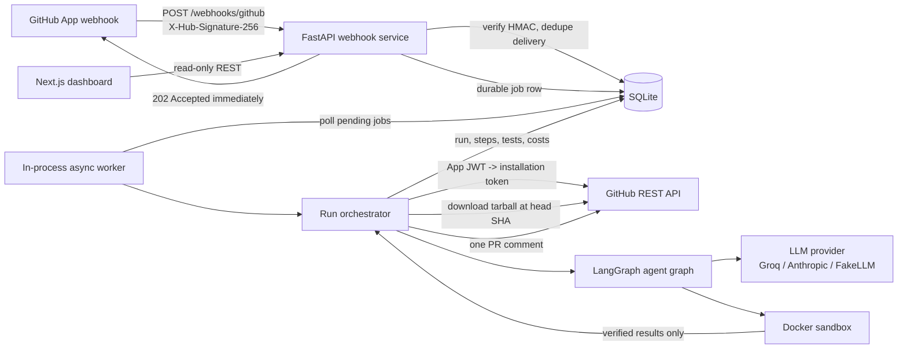
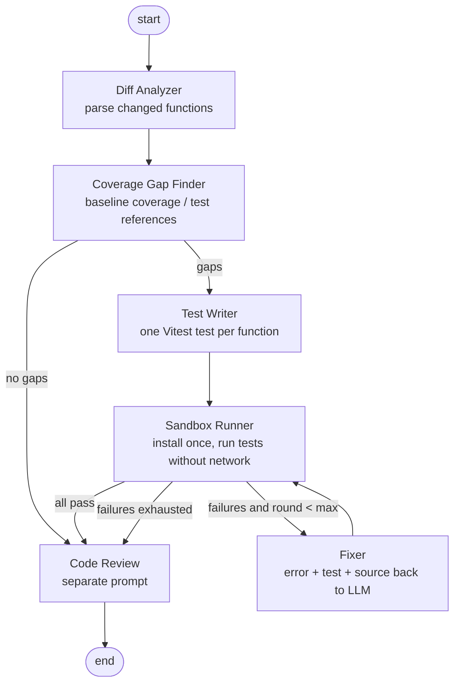

# Architecture

> Status after Phase 10. The webhook, worker, run processor, agent graph, LLM/config layer,
> sandbox, Next.js dashboard, demo repository, CI matrix and documentation are implemented.
> The Phase 9 local smoke executed the real pipeline with real npm/Vitest, a fake GitHub
> client, `FakeLLM` and `LocalSandboxRunner`; it is **not** Docker or live-provider
> verification. Docker is unavailable on the build machine, so container execution, image
> builds, Compose and GitHub Actions remain unverified. Every table and field below reflects
> the implemented SQLAlchemy models.

## 1. System view

The webhook service and worker run in one process for this project. The job table is
the source of truth, so the worker can be split into its own deployment later without
changing the API.

## 2. Agent graph

The graph is a `langgraph.graph.StateGraph` over a typed `AgentState` with nodes
`analyze`, `find_gaps`, `write`, `execute`, `fix` and `review`. Conditional edges
enforce the retry cap; the loop counter lives in state and per-test attempt counts are
stored on `TestProposal`. The nodes live in `backend/app/agents/graph.py`; the Phase 6
run processor persists the result and posts the PR comment outside this graph.

### LLM, config and generated-test policy

- `AgentDependencies` injects settings, `RepoConfig`, a `BudgetedLLM` and a sandbox
  object. Tests substitute `FakeLLM` and an in-memory sandbox.
- `BudgetedLLM` enforces per-run call, token and cost caps. `.prguard.yml` may tighten
  the settings defaults; the run cost summary is returned in `PipelineResult.cost`.
- The writer receives source plus a suggested relative test path. Proposals pass through
  Pydantic parsing and a static policy (path containment, suffix, size, overwrite,
  required assertions, forbidden modules/code, import allow-list) before writing.
- Untrusted prompt payloads are wrapped in explicit tags and closing-tag text is
  neutralized. This is defence in depth; Docker remains the execution boundary.
- The test phase is always network-disabled. Install runs once per pipeline and may use
  the network when `.prguard.yml` allows it. A draft is verified only when the Vitest
  report marks it passing and, if coverage names the function, its hit count is non-zero.
- UI functions are skipped unless `include_ui_tests` is true; when enabled they receive
  Vitest/jsdom tests. Playwright generation is not part of this writer (D022).

### Run processor

`RunProcessor` (`backend/app/run_processor.py`) owns one job after the worker claims it:

1. Load the run row and create a fresh temporary workspace outside the repository.
2. Fetch the PR diff and head tarball with the installation token; extract with path,
   traversal, link, size and entry-count checks.
3. Load `.prguard.yml` from the head and persist the public config on the run.
4. Analyze the diff and, unless disabled, run install plus the repository's own test
   command with coverage as the baseline (network policy is the same as the graph).
5. Build an `AgentDependencies` with the baseline coverage and hand control to the graph.
   A successful baseline install is reused by the graph; a failed baseline is reported
   but does not abort the run.
6. Persist counters, cost, coverage, per-node steps, generated tests, sandbox executions
   and the review. Rows are replaced if the same run is retried.
7. Render and post one PR comment, then store its id/url. A run that already has a
   `comment_id` is not commented again.

The processor accepts an injected GitHub client, sandbox, workspace root, LLM factory and
pipeline runner. Tests use fakes for all five; production uses `GitHubClient`,
`build_sandbox`, `build_budgeted_llm` and `run_agent_pipeline`. Workspace cleanup is
unconditional in a `finally` block.

### Dashboard and read-only API

The dashboard is a Next.js 15 App Router application under `dashboard/`. It is deliberately
a view, not a second control plane:

- `backend/app/api/routes.py` exposes four GET-only endpoints: `/api/runs` (newest first,
  paginated, optional status/repo filters), `/api/runs/{id}` (run plus steps, tests,
  sandbox executions and review), `/api/stats` (aggregate counters) and `/api/demo`
  (demo flag/run count). There is no create, retry, delete or comment endpoint.
- Pages are server components with `dynamic = "force-dynamic"`. They call `getRuns`,
  `getRun` and `getStats` from `dashboard/lib/api.ts`; the API base URL is read from
  `PRGUARD_API_URL` (server-to-server) and falls back to `NEXT_PUBLIC_API_URL` for local
  development. Browser code does not fetch the API, so the API does not need a public
  CORS origin for dashboard reads.
- `/api/runs` uses `limit`/`offset` from the URL with bounds (1–100, non-negative), a
  validated status enum and a case-insensitive, escaped repository substring. The page
  clamps the same values so a hand-edited URL cannot request an unbounded page.
- The detail view shows verified test code, unverified names/reasons, sandbox commands and
  captured output, the step timeline, review text, effective config and cost/token
  metadata. Empty states distinguish "no run", "no gap" and "no execution recorded".
- Rendering is read-only by construction: React escapes all run values, test code is
  displayed as text inside `<pre>`, and external links are limited to stored GitHub URLs.
  Dashboard unit/component tests mock `lib/api.ts`; Playwright E2E uses a deterministic
  mock API server and a production Next build.

### Demo repository

`demo-repo/` is a standalone TypeScript/Vitest package used as the reference target. Its
baseline functions are fully tested; `demo-pr.patch` adds an exported `normalizeScore`
without a test so the coverage gap is unambiguous. The directory has its own lockfile and
`.prguard.yml`, and the parent CI runs its tests/typecheck as a smoke test. It is not a
workspace package, because the pipeline downloads and runs a repository as the project
root (D032).

## 3. Data flow for one pull request

1. GitHub sends `pull_request` (`opened` or `synchronize`) with an HMAC signature.
2. The webhook route reads the **raw body**, verifies HMAC-SHA-256 in constant time,
   checks the delivery id, inserts `deliveries`, creates `runs` + `jobs`, returns 202.
   A duplicate delivery is a no-op.
3. The run processor claims the job, downloads the PR head tarball with an installation
   token, and safely extracts it (path traversal, link, size and entry-count checks).
4. Diff Analyzer parses changed files and unified hunks, extracts added/changed
   TypeScript functions with their signatures and line ranges.
5. Gap Finder applies `.prguard.yml` path filters, then uses baseline Istanbul coverage
   as the authoritative signal (zero hits = gap). Without coverage it falls back to test
   file references and default-export sibling tests, deliberately over-reporting gaps.
6. Test Writer asks the LLM for strict JSON containing a test file per gap. Output is
   parsed with Pydantic, passed through the static safety policy, and only then written
   to the sandbox workspace.
7. Sandbox Runner creates a fresh container: install phase (network enabled only if
   configured), then test phase (`network_disabled=True`, non-root, read-only root FS,
   memory/CPU/PID limits, timeout). Output is parsed into per-test results and coverage.
8. Failures go to the Fixer with the failing test, source, and truncated error. After
   `max_fix_attempts` rounds the test is marked `rejected` and reported as unverified.
9. The review node produces Markdown commentary. The run processor persists results and
   posts one comment containing verified tests only, coverage delta, costs and unverified
   functions. The dashboard reads the same persisted state.
10. The dashboard server fetches `GET /api/runs`, `/api/runs/{id}` and `/api/stats` from
    the FastAPI process and renders the result. No dashboard action mutates a run.

## 4. Sandbox execution boundary

`DockerSandboxRunner` is the only backend treated as a security boundary. It receives a
workspace plus an argv list and returns a typed `SandboxResult`; it never accepts a
shell string and never forwards the host environment.

| Control | Docker request |
| --- | --- |
| Non-root | `user="10001:10001"` |
| Immutable root filesystem | `read_only=True`; workspace is the only rw bind mount |
| Network | test phase `network_disabled=True`, enforced in code; install phase may opt in |
| Capabilities | `cap_drop=["ALL"]`, `security_opt=["no-new-privileges:true"]` |
| Resource limits | memory, `nano_cpus`, `pids_limit`, 64 MB `/dev/shm` |
| Temporary files | `/tmp` is a `rw,noexec,nosuid,size=256m` tmpfs |
| Timeout | SDK wait timeout; on expiry `kill()` then unconditional removal |
| Secrets | fixed environment baseline; secret-looking/arbitrary names rejected |

The image is `backend/sandbox/Dockerfile` (`prguard-sandbox:node20`), built from
`node:20-bookworm-slim` with uid/gid 10001. The runner chmods the temporary workspace so
the non-root sandbox user can install `node_modules` and write coverage output. Because
the workspace is a bind mount, the path must be visible to the Docker daemon; a remote
daemon deployment must copy the workspace into a volume instead.

`LocalSandboxRunner` exists for development and demo recording. It runs an
allow-listed executable directly on the host, cannot disable networking, and reports
`isolation="local (NOT a security boundary)"` plus `network_disabled=False` so no caller
can mistake it for the Docker boundary.

Docker-specific integration tests are marked `docker`; when the daemon or image is
missing, they are skipped and reported, never treated as passing.

## 5. Tech stack and why

| Choice | Why | Alternatives considered |
| --- | --- | --- |
| FastAPI | Async I/O for webhooks/GitHub/LLM calls, typed request/response models, cheap to test with `TestClient`. | Flask (sync, less typed), Django (too heavy for one service). |
| LangGraph | Explicit typed state and conditional edges, retry loop visible in code, per-node tracing. | One giant prompt (no isolation, harder retries), CrewAI (less control over deterministic flow), plain Python (possible; LangGraph gives checkpoints/visual graph). |
| SQLite + SQLAlchemy | Zero-ops persistence for a single-instance webhook worker; SQLAlchemy keeps Postgres migration straightforward. | Postgres (unnecessary operational cost for demo), Redis (loses relational run history unless duplicated). |
| SQLite durable queue + asyncio worker | No extra infrastructure; survives restarts; webhook latency stays low. | Celery/RQ + Redis (better at scale, extra service), FastAPI BackgroundTasks (not durable). |
| Docker SDK | Programmatic container lifecycle, limits and network controls are explicit. | subprocess (no isolation, unacceptable), Firecracker (stronger but far more ops). |
| Vitest / Playwright | Same tools as target JS/TS repos; JSON reporters are machine-readable. | Jest (slower, less native ESM), Cypress (heavier). |
| Next.js 15 | App Router, server components, easy Vercel deployment. | Vite SPA (no Vercel server features), Remix. |
| Groq / Anthropic adapters behind one interface | Provider swap via env var; deterministic FakeLLM keeps tests offline and cheap. | LangChain model wrappers (extra abstraction; not needed for two REST APIs). |

## 6. Data models

All ids are UUID strings. Times are UTC. SQLite stores JSON columns as text but
SQLAlchemy exposes Python dicts.

### `deliveries`
| Field | Type | Meaning |
| --- | --- | --- |
| `id` | UUID PK | Internal id. |
| `delivery_id` | string unique | `X-GitHub-Delivery`; idempotency key. |
| `event` | string | GitHub event name. |
| `action` | string nullable | Event action (`opened`, `synchronize`). |
| `payload_sha256` | string | Hash of raw body, audit/debug only. |
| `received_at` | datetime | Receipt time. |

### `runs`
| Field | Type | Meaning |
| --- | --- | --- |
| `id` | UUID PK | Run id used in dashboard URLs. |
| `delivery_id` | FK unique | One run per delivery. |
| `repo_full_name`, `repo_owner`, `repo_name` | strings | Repository identity. |
| `pr_number` | int | PR number. |
| `head_sha`, `base_sha` | strings | Exact commits analysed; `(repo_full_name, head_sha)` is unique (`uq_runs_repo_head`). |
| `installation_id` | int | GitHub App installation. |
| `sender_login` | string | Actor shown in UI. |
| `is_fork` | bool | Fork PR policy flag. |
| `status` | string | `queued`, `running`, `succeeded`, `failed`, `skipped`. |
| `config` | JSON | Parsed `.prguard.yml` used for this run. |
| `summary` | text | Human summary. |
| `error` | text | Terminal error, if any. |
| `files_changed`, `functions_found`, `tests_generated`, `tests_verified` | int | Dashboard counters. |
| `llm_calls`, `input_tokens`, `output_tokens`, `cost_usd` | int/float | Cost accounting. |
| `duration_ms` | int | Wall-clock duration. |
| `coverage_before`, `coverage_after`, `coverage_delta` | float | Measured percentages. |
| `comment_id`, `comment_url` | int/string | Posted PR comment. |
| `created_at`, `updated_at` | datetime | Lifecycle. |

### `jobs`
| Field | Type | Meaning |
| --- | --- | --- |
| `id` | UUID PK | Job id. |
| `run_id` | FK unique | Job payload. |
| `status` | string | `pending`, `processing`, `done`, `failed`. |
| `attempts` | int | Worker crash/retry counter. |
| `last_error` | text | Last failure. |
| `created_at`, `started_at`, `finished_at` | datetime | Queue timing. |

### `agent_steps`
| Field | Type | Meaning |
| --- | --- | --- |
| `id` | UUID PK | Step id. |
| `run_id` | FK | Parent run. |
| `sequence` | int | Display order. |
| `node` | string | Graph node name. |
| `status` | string | `running`, `succeeded`, `failed`, `skipped`. |
| `attempt` | int | Fixer attempt number. |
| `summary` | text | Short human-readable result. |
| `detail` | JSON | Structured trace (paths, counts, redacted errors). |
| `input_tokens`, `output_tokens`, `cost_usd` | int/float | Per-step cost. |
| `duration_ms` | int | Node duration. |
| `error` | text | Failure. |
| `created_at` | datetime | Start time. |

### `generated_tests`
| Field | Type | Meaning |
| --- | --- | --- |
| `id` | UUID PK | Test id. |
| `run_id` | FK | Parent run. |
| `file_path` | string | Path written in sandbox. |
| `function_name` | string | Function under test. |
| `source_file` | string | Source under test. |
| `framework` | string | `vitest`; `playwright` is reserved for a future writer. |
| `content` | text | Full generated file. |
| `status` | string | `proposed`, `verified`, `rejected`. |
| `attempts` | int | Writer+fixer attempts. |
| `last_error` | text | Last failure output. |
| `created_at` | datetime | Creation time. |

### `sandbox_executions`
| Field | Type | Meaning |
| --- | --- | --- |
| `id` | UUID PK | Execution id. |
| `run_id` | FK | Parent run. |
| `phase` | string | `install` or `test`. |
| `image` | string | Pinned image. |
| `command` | JSON | Exact argv. |
| `network_disabled` | bool | Must be true for test phase. |
| `status` | string | `passed`, `failed`, `timeout`, `error`. |
| `exit_code` | int nullable | Process exit code. |
| `timed_out` | bool | Killed by watchdog. |
| `duration_ms` | int | Runtime. |
| `stdout`, `stderr` | text | Truncated logs. |
| `coverage` | JSON nullable | Coverage summary. |
| `created_at` | datetime | Start time. |

### `code_reviews`
| Field | Type | Meaning |
| --- | --- | --- |
| `id` | UUID PK | Review id. |
| `run_id` | FK unique | Parent run. |
| `content` | text | Markdown review. |
| `cost_usd` | float | LLM cost. |
| `created_at` | datetime | Creation time. |

## 7. Failure modes

- **GitHub down / rate limited:** the processor raises `GitHubAPIError`; the job stays
  failed with the error, and no comment is posted. The webhook already returned 202 because
  enqueue is durable. A retry from the dashboard is a future extension.
- **LLM returns malformed JSON:** schema validation rejects it, the gap is reported as
  skipped; no test is executed.
- **LLM budget exhausted:** remaining gaps are not written; already verified tests are
  kept, the cap hit is recorded in `errors`/cost, and the review may be skipped.
- **Invalid `.prguard.yml`:** the run fails with a config error before any command or
  generated test is executed; the default config is not silently substituted.
- **Dependency install fails:** every draft is rejected with the install failure, the
  test phase is not run, and the comment lists them as unverified.
- **Baseline tests fail or produce no coverage:** the run continues. Istanbul coverage is
  used if present; otherwise the gap finder falls back to test-file references. The
  baseline step records the failure instead of pretending coverage was measured.
- **Vitest report is missing:** verification falls back to the sandbox exit status only
  when no report file exists; a present report that omits a draft rejects that draft.
- **Coverage reports zero executions:** an otherwise passing test is rejected, because
  the target function did not actually run.
- **Sandbox daemon unavailable:** run fails cleanly and no comment is posted. Results
  already persisted by the processor remain visible for diagnosis.
- **Comment posting fails:** results remain persisted, the run is marked failed, and no
  `comment_id` is stored, so a retry may post. A crash after GitHub accepts the comment
  but before the id is stored is a residual duplicate-comment window (D026).
- **Test never passes:** dropped after the attempt cap and listed as "could not verify".
- **Worker crashes mid-run:** `jobs.status=processing` + stale `started_at` is reclaimed
  by the worker on startup (Phase 2).
- **Duplicate webhook:** unique `delivery_id` returns 200/202 without a second run; a new
  delivery for an already-analysed `(repo, head_sha)` returns `duplicate_commit` instead of
  spending again.
- **Prompt injection in diff:** all repository content is wrapped as untrusted data with
  closing tags neutralized; generated code is static-checked and only executed inside the
  sandbox.

## 8. Verification and evidence

The following were executed on the development machine:

| Check | Result |
| --- | --- |
| Backend `pytest -q --cov=app` | 426 passed, 1 skipped, 95.16% branch-aware |
| Backend `ruff check` / `ruff format --check` | clean |
| Dashboard `vitest run --coverage` | 29 passed, 99.21% stmts / 91.97% branches / 100% funcs / lines |
| Dashboard `next build` | success |
| Dashboard Playwright against the mock API | 3 passed |
| `demo-repo` tests / coverage / typecheck | 11 passed, 100% / clean |
| `npm audit` (dashboard, demo-repo) | 0 vulnerabilities |
| Phase 9 local smoke | succeeded: 1 verified test, 78.57% -> 100.00%, 2 FakeLLM calls, 1,294 tokens |

The local smoke (`backend/scripts/demo_smoke.py`) is the only end-to-end execution. It uses
real npm/Vitest and real persistence, but a fake GitHub client, `FakeLLM` and
`LocalSandboxRunner`. The dashboard screenshots in `docs/screenshots/` were captured from
the SQLite database it produced, served by FastAPI and a production Next build. They must
be described as a local FakeLLM demo.

Not verified in this environment:

- Docker container creation, image builds, Compose, and the real-daemon integration test
  (the test is skipped, never reported as passed).
- Live GitHub App webhook delivery, installation tokens, tarball download and comment
  posting.
- Live Groq or Anthropic calls; adapters use `httpx.MockTransport`.
- GitHub Actions execution; the workflow parses, but there is no remote and no Docker
  daemon here. Local equivalents of each job were run individually.

These gaps are called out in the README, `SECURITY.md`, `INTERVIEW_PREP.md` and
`PROGRESS.md` so no mocked path is presented as production evidence.
