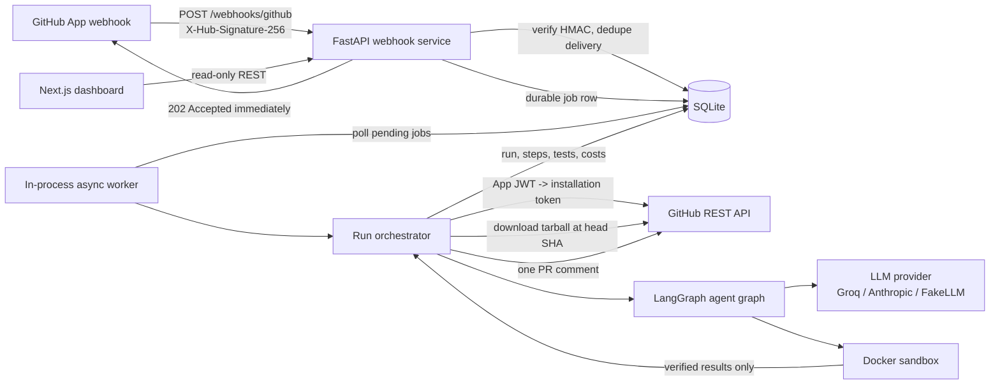
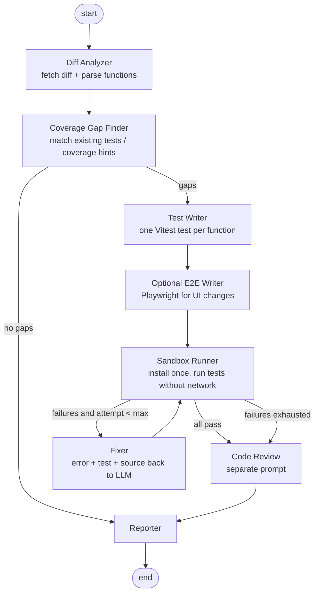

# Architecture

> Draft after Phase 1. Data-flow details and failure modes are expanded in Phase 10;
> every table and field below already reflects the implemented SQLAlchemy models.

## 1. System view

The webhook service and worker run in one process for this project. The job table is
the source of truth, so the worker can be split into its own deployment later without
changing the API.

## 2. Agent graph

The graph is a `langgraph.graph.StateGraph` over a typed `PRGuardState`. Conditional
edges enforce the retry cap; the loop counter lives in state and is also persisted in
`generated_tests.attempts`.

## 3. Data flow for one pull request

1. GitHub sends `pull_request` (`opened` or `synchronize`) with an HMAC signature.
2. The webhook route reads the **raw body**, verifies HMAC-SHA-256 in constant time,
   checks the delivery id, inserts `deliveries`, creates `runs` + `jobs`, returns 202.
   A duplicate delivery is a no-op.
3. The worker claims the job, downloads the PR head tarball with an installation token,
   and safely extracts it (path traversal and size checks).
4. Diff Analyzer parses changed files and unified hunks, extracts added/changed
   TypeScript functions with their signatures and line ranges.
5. Gap Finder ignores generated/test files and files outside `.prguard.yml` paths, then
   checks existing test files for references to each function.
6. Test Writer asks the LLM for strict JSON containing a test file per gap. Output is
   schema-validated and passed through a static safety check before it is written to
   the sandbox workspace.
7. Sandbox Runner creates a fresh container: install phase (network enabled only if
   configured), then test phase (`network_disabled=True`, non-root, read-only root FS,
   memory/CPU/PID limits, timeout). Output is parsed into per-test results and coverage.
8. Failures go to the Fixer with the failing test, source, and truncated error. After
   `max_attempts` the test is marked `rejected` and reported as unverified.
9. Reporter posts one comment containing verified tests only, coverage delta, costs and
   unverified functions. The dashboard reads the same persisted state.

## 4. Sandbox execution boundary

`DockerSandboxRunner` is the only backend treated as a security boundary. It receives a
workspace plus an argv list and returns a typed `SandboxResult`; it never accepts a
shell string and never forwards the host environment.

| Control | Docker request |
| --- | --- |
| Non-root | `user="10001:10001"` |
| Immutable root filesystem | `read_only=True`; workspace is the only rw bind mount |
| Network | test phase `network_disabled=True`, enforced in code; install phase may opt in |
| Capabilities | `cap_drop=["ALL"]`, `security_opt=["no-new-privileges:true"]` |
| Resource limits | memory, `nano_cpus`, `pids_limit`, 64 MB `/dev/shm` |
| Temporary files | `/tmp` is a `rw,noexec,nosuid,size=256m` tmpfs |
| Timeout | SDK wait timeout; on expiry `kill()` then unconditional removal |
| Secrets | fixed environment baseline; secret-looking/arbitrary names rejected |

The image is `backend/sandbox/Dockerfile` (`prguard-sandbox:node20`), built from
`node:20-bookworm-slim` with uid/gid 10001. The runner chmods the temporary workspace so
the non-root sandbox user can install `node_modules` and write coverage output. Because
the workspace is a bind mount, the path must be visible to the Docker daemon; a remote
daemon deployment must copy the workspace into a volume instead.

`LocalSandboxRunner` exists for development and demo recording. It runs an
allow-listed executable directly on the host, cannot disable networking, and reports
`isolation="local (NOT a security boundary)"` plus `network_disabled=False` so no caller
can mistake it for the Docker boundary.

Docker-specific integration tests are marked `docker`; when the daemon or image is
missing, they are skipped and reported, never treated as passing.

## 5. Tech stack and why

| Choice | Why | Alternatives considered |
| --- | --- | --- |
| FastAPI | Async I/O for webhooks/GitHub/LLM calls, typed request/response models, cheap to test with `TestClient`. | Flask (sync, less typed), Django (too heavy for one service). |
| LangGraph | Explicit typed state and conditional edges, retry loop visible in code, per-node tracing. | One giant prompt (no isolation, harder retries), CrewAI (less control over deterministic flow), plain Python (possible; LangGraph gives checkpoints/visual graph). |
| SQLite + SQLAlchemy | Zero-ops persistence for a single-instance webhook worker; SQLAlchemy keeps Postgres migration straightforward. | Postgres (unnecessary operational cost for demo), Redis (loses relational run history unless duplicated). |
| SQLite durable queue + asyncio worker | No extra infrastructure; survives restarts; webhook latency stays low. | Celery/RQ + Redis (better at scale, extra service), FastAPI BackgroundTasks (not durable). |
| Docker SDK | Programmatic container lifecycle, limits and network controls are explicit. | subprocess (no isolation, unacceptable), Firecracker (stronger but far more ops). |
| Vitest / Playwright | Same tools as target JS/TS repos; JSON reporters are machine-readable. | Jest (slower, less native ESM), Cypress (heavier). |
| Next.js 15 | App Router, server components, easy Vercel deployment. | Vite SPA (no Vercel server features), Remix. |
| Groq / Anthropic adapters behind one interface | Provider swap via env var; deterministic FakeLLM keeps tests offline and cheap. | LangChain model wrappers (extra abstraction; not needed for two REST APIs). |

## 6. Data models

All ids are UUID strings. Times are UTC. SQLite stores JSON columns as text but
SQLAlchemy exposes Python dicts.

### `deliveries`
| Field | Type | Meaning |
| --- | --- | --- |
| `id` | UUID PK | Internal id. |
| `delivery_id` | string unique | `X-GitHub-Delivery`; idempotency key. |
| `event` | string | GitHub event name. |
| `action` | string nullable | Event action (`opened`, `synchronize`). |
| `payload_sha256` | string | Hash of raw body, audit/debug only. |
| `received_at` | datetime | Receipt time. |

### `runs`
| Field | Type | Meaning |
| --- | --- | --- |
| `id` | UUID PK | Run id used in dashboard URLs. |
| `delivery_id` | FK unique | One run per delivery. |
| `repo_full_name`, `repo_owner`, `repo_name` | strings | Repository identity. |
| `pr_number` | int | PR number. |
| `head_sha`, `base_sha` | strings | Exact commits analysed. |
| `installation_id` | int | GitHub App installation. |
| `sender_login` | string | Actor shown in UI. |
| `is_fork` | bool | Fork PR policy flag. |
| `status` | string | `queued`, `running`, `succeeded`, `failed`, `skipped`. |
| `config` | JSON | Parsed `.prguard.yml` used for this run. |
| `summary` | text | Human summary. |
| `error` | text | Terminal error, if any. |
| `files_changed`, `functions_found`, `tests_generated`, `tests_verified` | int | Dashboard counters. |
| `llm_calls`, `input_tokens`, `output_tokens`, `cost_usd` | int/float | Cost accounting. |
| `duration_ms` | int | Wall-clock duration. |
| `coverage_before`, `coverage_after`, `coverage_delta` | float | Measured percentages. |
| `comment_id`, `comment_url` | int/string | Posted PR comment. |
| `created_at`, `updated_at` | datetime | Lifecycle. |

### `jobs`
| Field | Type | Meaning |
| --- | --- | --- |
| `id` | UUID PK | Job id. |
| `run_id` | FK unique | Job payload. |
| `status` | string | `pending`, `processing`, `done`, `failed`. |
| `attempts` | int | Worker crash/retry counter. |
| `last_error` | text | Last failure. |
| `created_at`, `started_at`, `finished_at` | datetime | Queue timing. |

### `agent_steps`
| Field | Type | Meaning |
| --- | --- | --- |
| `id` | UUID PK | Step id. |
| `run_id` | FK | Parent run. |
| `sequence` | int | Display order. |
| `node` | string | Graph node name. |
| `status` | string | `running`, `succeeded`, `failed`, `skipped`. |
| `attempt` | int | Fixer attempt number. |
| `summary` | text | Short human-readable result. |
| `detail` | JSON | Structured trace (paths, counts, redacted errors). |
| `input_tokens`, `output_tokens`, `cost_usd` | int/float | Per-step cost. |
| `duration_ms` | int | Node duration. |
| `error` | text | Failure. |
| `created_at` | datetime | Start time. |

### `generated_tests`
| Field | Type | Meaning |
| --- | --- | --- |
| `id` | UUID PK | Test id. |
| `run_id` | FK | Parent run. |
| `file_path` | string | Path written in sandbox. |
| `function_name` | string | Function under test. |
| `source_file` | string | Source under test. |
| `framework` | string | `vitest` or `playwright`. |
| `content` | text | Full generated file. |
| `status` | string | `proposed`, `verified`, `rejected`. |
| `attempts` | int | Writer+fixer attempts. |
| `last_error` | text | Last failure output. |
| `created_at` | datetime | Creation time. |

### `sandbox_executions`
| Field | Type | Meaning |
| --- | --- | --- |
| `id` | UUID PK | Execution id. |
| `run_id` | FK | Parent run. |
| `phase` | string | `install` or `test`. |
| `image` | string | Pinned image. |
| `command` | JSON | Exact argv. |
| `network_disabled` | bool | Must be true for test phase. |
| `status` | string | `passed`, `failed`, `timeout`, `error`. |
| `exit_code` | int nullable | Process exit code. |
| `timed_out` | bool | Killed by watchdog. |
| `duration_ms` | int | Runtime. |
| `stdout`, `stderr` | text | Truncated logs. |
| `coverage` | JSON nullable | Coverage summary. |
| `created_at` | datetime | Start time. |

### `code_reviews`
| Field | Type | Meaning |
| --- | --- | --- |
| `id` | UUID PK | Review id. |
| `run_id` | FK unique | Parent run. |
| `content` | text | Markdown review. |
| `cost_usd` | float | LLM cost. |
| `created_at` | datetime | Creation time. |

## 7. Failure modes (draft, expanded in Phase 10)

- **GitHub down / rate limited:** job stays failed with error; retry from dashboard is a
  future extension. Webhook still returns 202 after durable enqueue.
- **LLM returns malformed JSON:** schema validation rejects it, the gap is reported as
  skipped; no test is executed.
- **Sandbox daemon unavailable:** run fails cleanly; no unverified tests are posted.
- **Test never passes:** dropped after the attempt cap and listed as "could not verify".
- **Worker crashes mid-run:** `jobs.status=processing` + stale `started_at` is reclaimed
  by the worker on startup (Phase 2).
- **Duplicate webhook:** unique `delivery_id` returns 200/202 without a second run.
- **Prompt injection in diff:** all repository content is wrapped as untrusted data;
  generated code is static-checked and only executed inside the sandbox.
