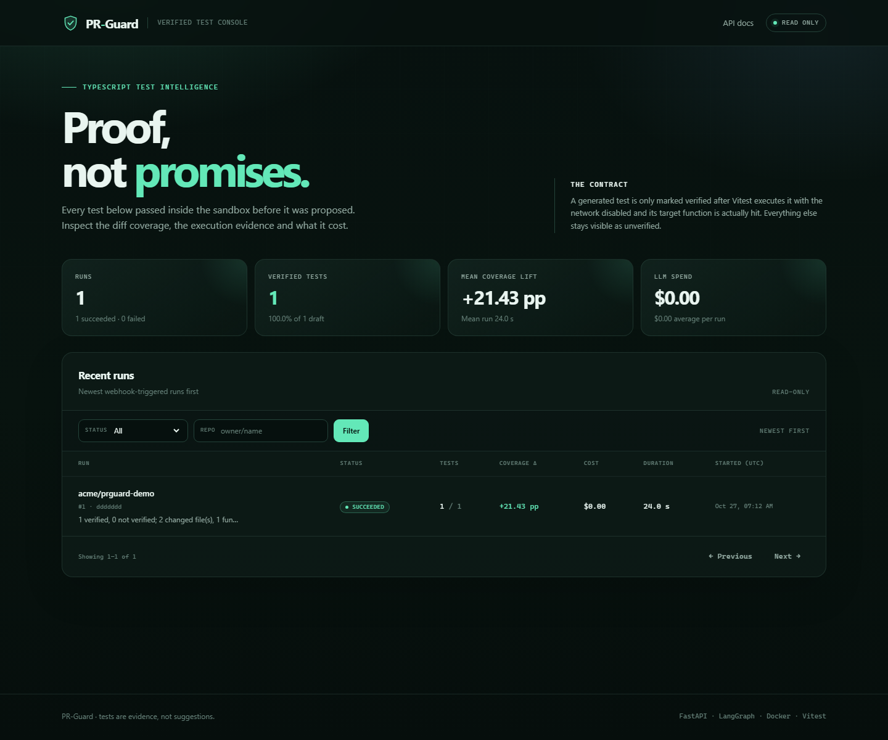
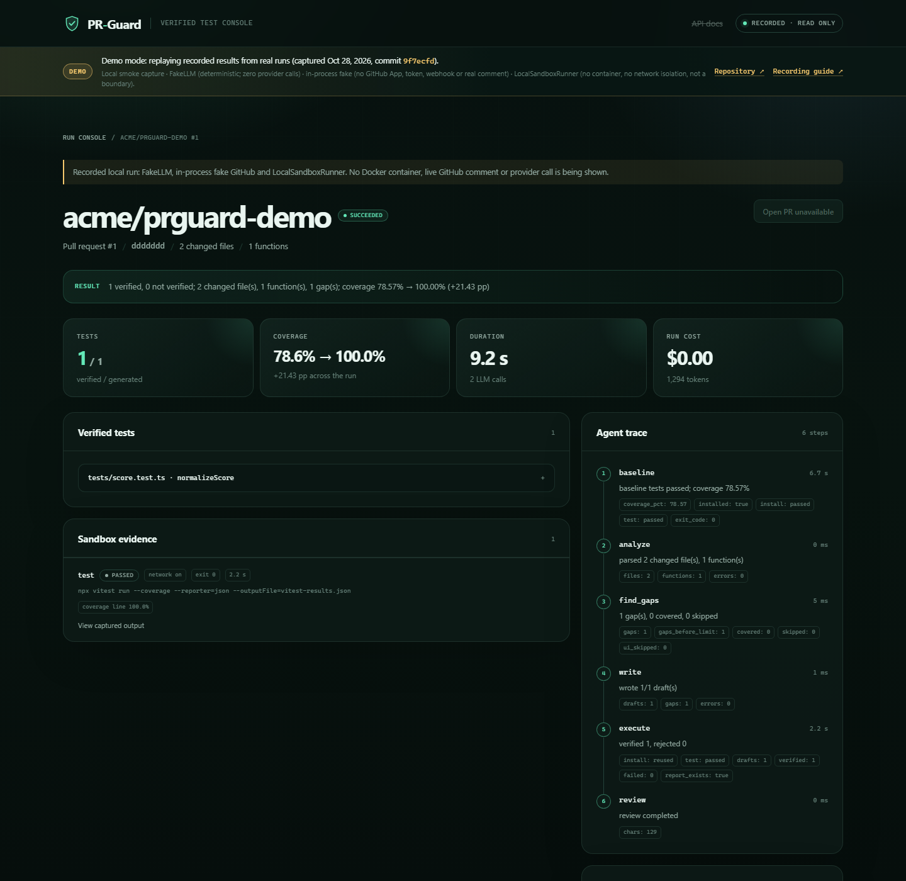
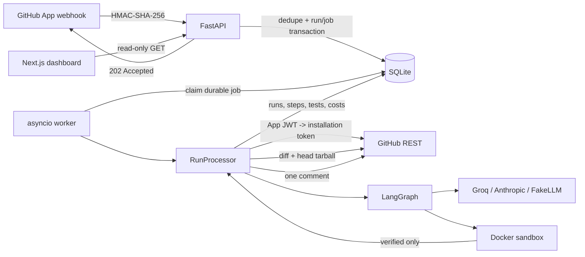

# PR-Guard

**Tests that are written by an LLM, but only posted after they pass in a sandbox.**

PR-Guard is a GitHub App for TypeScript repositories. On a pull request it finds changed
functions whose code was never executed by the project's own test suite, generates focused
Vitest tests, and runs them in an isolated Docker container. A test reaches the PR only if
it **passed in the sandbox** and, **when coverage is available, actually executed the target
function**. Everything else is reported as unverified, with a reason.

The generated code is treated as hostile. The prompt never contains a GitHub token, an LLM
key or a database URL, and test execution has no network, no root filesystem write, no Linux
capabilities and a hard timeout.



> Overview captured from a **local** Phase 9 demo run (`LocalSandboxRunner` + `FakeLLM` +
> fake GitHub fixtures). It is not a Docker, live-GitHub or live-LLM run.



> Run detail: six persisted steps, baseline coverage 78.57% -> 100.00%, one verified test,
> the review text and run metadata. The same local-demo caveat applies.

## Why it is interesting

Coverage tools tell you a percentage. They do not tell a reviewer "this new function has
never executed". PR-Guard works on the delta:

1. Parse the unified diff, including quoted paths, renames and binary files.
2. Extract changed functions with tree-sitter (top-level functions, arrows, class/object
   methods, default exports).
3. Use baseline Istanbul **function hit counts** as the authoritative gap signal; fall back
   to test-file references only when coverage is unavailable.
4. Ask a provider-agnostic LLM for strict JSON Vitest proposals.
5. Statically validate paths, imports and dangerous code.
6. Execute install once, then tests with the network disabled; require a passing per-file
   Vitest result and, when coverage is available, a non-zero hit count for the target.
7. Retry failed drafts through a bounded fixer (max 3 rounds), then persist everything and
   post **one** comment containing only verified tests.

## Verification, honestly

This is the most important section. It separates what was measured from what was not.

| Area | Status | Evidence |
| --- | --- | --- |
| Backend unit/integration tests | **Passed** | `426 passed, 1 skipped`, 95.16% branch-aware coverage |
| Backend lint/format | **Passed** | `ruff check` and `ruff format --check` clean |
| Local end-to-end smoke | **Passed** | Real npm + Vitest, real SQLite/persistence, fake GitHub, FakeLLM; 1 verified test, 78.57% -> 100.00% |
| Dashboard unit/component tests | **Passed** | 29 tests, 99.21% statements / 91.97% branches / 100% functions / 100% lines |
| Dashboard production build | **Passed** | `next build` succeeds |
| Dashboard E2E | **Passed** | 3 Playwright tests against a deterministic mock API |
| Demo repository | **Passed** | 11 tests, 100% statements/branches/functions/lines |
| npm audit (dashboard, demo) | **Passed** | 0 vulnerabilities |
| **Docker sandbox execution** | **Not verified** | Docker is not installed on the build machine; the real-daemon test is skipped |
| **Docker image builds / Compose** | **Not verified** | No daemon available; Dockerfiles are committed but unexecuted |
| **Live GitHub App** | **Not verified** | No App installation or credentials; fakes and `httpx.MockTransport` used |
| **Live Groq / Anthropic** | **Not verified** | No provider keys; adapters tested with mocked HTTP |
| **GitHub Actions** | **Not run** | No remote and no Docker daemon; workflow parses locally |

The one skipped backend test is the real-Docker integration test. It is reported as skipped,
never as passed. The local smoke runner is labelled
`local (NOT a security boundary)` and reports `network_disabled=False` because it cannot
enforce isolation. Do not read its success as container evidence.

## Architecture



The full data flow, data model and failure modes are in [`ARCHITECTURE.md`](ARCHITECTURE.md).
The security posture and residual risks are in [`SECURITY.md`](SECURITY.md).

### The agent graph

```
START -> analyze -> find_gaps
find_gaps --no gaps--> review -> END
find_gaps --gaps-----> write -> execute
execute --failures and attempts < cap--> fix -> execute
execute --otherwise-------------------> review -> END
```

`analyze` parses the diff, `find_gaps` applies coverage/path/export filters, `write` produces
statically validated drafts, `execute` is the trust decision, `fix` repairs only failures,
and `review` optionally writes short Markdown commentary. The graph state is persisted as
per-node steps for the dashboard.

## Stack

| Layer | Choice |
| --- | --- |
| API | FastAPI, Python 3.11 target, Pydantic v2 |
| Agent | LangGraph state machine, six nodes, typed state |
| LLM | One `LLMClient` protocol: Groq, Anthropic, deterministic `FakeLLM` |
| Analysis | tree-sitter TypeScript/TSX; Istanbul/Vitest JSON coverage |
| Execution | Docker SDK; non-root, read-only, no network for tests, limits, timeout, cleanup |
| Persistence | SQLite + SQLAlchemy 2; durable `jobs` table, one in-process worker |
| Dashboard | Next.js 15 App Router, React 19, TypeScript, server components |
| Tests | pytest + coverage, Vitest + React Testing Library, Playwright |
| Packaging | Docker Compose, standalone Next image, GitHub Actions matrix |

## Repository layout

```
backend/
  app/
    webhooks/     HMAC, payload validation, dedupe and enqueue
    queue/        durable job claim, stale recovery, asyncio worker
    github/       App JWT, installation-token client, safe tarball extraction
    diff/         unified-diff parser, tree-sitter extraction, changed-line filter
    coverage/     Istanbul parser, function hit lookup, gap finder
    config/       untrusted `.prguard.yml` validation
    llm/          provider protocol, Groq/Anthropic adapters, FakeLLM, budget
    agents/       LangGraph nodes, prompts, parsing, static policy, Vitest parsing
    sandbox/      Docker/local runners, limits, argv/env allow-lists
    run_processor.py  baseline, persistence, comment posting, cleanup
    api/          read-only dashboard endpoints
  sandbox/        sandbox image (Node 20, uid 10001)
  scripts/        demo_smoke.py local end-to-end harness
  tests/          pytest suite
dashboard/        Next.js read-only run console + Playwright E2E
demo-repo/        standalone TS library, 100% baseline coverage, untested demo PR
docs/screenshots/ captured dashboard images
```

## Quickstart

### Prerequisites

- Python 3.11+ (the project targets 3.11; local runs used 3.12.1)
- Node.js 20+
- Docker (required for the real sandbox; optional for the local demo path)
- A GitHub App and a provider key only for live use

### 1. Backend

```bash
cp .env.example .env
cd backend
python -m venv ../.venv
../.venv/Scripts/pip install -e ".[dev]"       # Windows
# source ../.venv/bin/activate && pip install -e ".[dev]"   # macOS/Linux

../.venv/Scripts/python -m pytest -q --cov=app
../.venv/Scripts/python -m uvicorn app.main:app --reload --port 8000
```

On macOS/Linux use `../.venv/bin/python` instead of `../.venv/Scripts/python`.
Health check: <http://localhost:8000/healthz>; API docs: `/docs`.

For a real run, set the GitHub App id, private key path/PEM, webhook secret, provider key
and a tunnel URL. The webhook endpoint is `POST /webhooks/github`.

### 2. Sandbox image (Docker)

```bash
docker build -t prguard-sandbox:node20 backend/sandbox
```

This image is separate from the API image: the API launches sibling containers from it, so
it must be present on the Docker host. `SANDBOX_MODE=docker` is the only security boundary.

### 3. Dashboard

```bash
cd dashboard
npm ci
PRGUARD_API_URL=http://localhost:8000 npm run dev
```

Open <http://localhost:3000>. `PRGUARD_API_URL` is used by server components, so FastAPI can
stay on a private network. `NEXT_PUBLIC_API_URL` is only a local fallback and the docs link.
On PowerShell, set `$env:PRGUARD_API_URL = "http://localhost:8000"` before `npm run dev`,
or add the variable to `dashboard/.env.local`.

```bash
npm test                 # Vitest + RTL
npm run test:coverage    # 90/85 thresholds
npm run typecheck
npm run build
npx playwright install chromium
npm run test:e2e         # mock API + production Next build
```

### 4. Demo repository

```bash
cd demo-repo
npm ci
npm test
npm run test:coverage
npm run typecheck
```

`demo-pr.patch` adds `normalizeScore` without a test. See
[`demo-repo/README.md`](demo-repo/README.md) for creating the demo PR.

### 5. Local end-to-end smoke (no Docker)

```bash
cd backend
../.venv/Scripts/python scripts/demo_smoke.py
```

This runs the real `Worker` + `RunProcessor` against the patched demo repository with real
npm/Vitest, a fake GitHub client and `FakeLLM`. It writes `data/demo.db` and
`data/demo-comment.md`, exits non-zero on failure, and prints the run id, coverage, counts,
steps and sandbox executions. **It uses `LocalSandboxRunner`: not a security boundary, no
network isolation.** To point the dashboard at it:

```bash
cd backend
../.venv/Scripts/python -m uvicorn app.main:app --port 8001
# in another terminal
cd dashboard
PRGUARD_API_URL=http://localhost:8001 npm run dev -- -p 3101
```

### 6. Docker Compose

```bash
docker build -t prguard-sandbox:node20 backend/sandbox
docker compose up --build
```

API on <http://localhost:8000>, dashboard on <http://localhost:3000>. Compose mounts the
Docker socket for Docker-outside-of-Docker (root-equivalent host access; see
[`SECURITY.md`](SECURITY.md)). The `demo-repo` profile runs its suite:
`docker compose --profile demo run --rm demo-repo`.

> The Compose stack and both application images have not been built or started in this
> environment because Docker is unavailable.

## Configuration

Environment variables live in `.env`; see [`.env.example`](.env.example). The most important:

| Variable | Default | Meaning |
| --- | --- | --- |
| `APP_ENV` | `development` | Production refuses the default webhook secret |
| `DATABASE_URL` | `sqlite:///./data/prguard.db` | SQLAlchemy URL |
| `GITHUB_APP_ID` / `GITHUB_PRIVATE_KEY_PATH` (or `GITHUB_PRIVATE_KEY`) | empty | App auth |
| `GITHUB_WEBHOOK_SECRET` | `change-me` | HMAC secret; must change in production |
| `LLM_PROVIDER` | `fake` | `fake`, `groq` or `anthropic` |
| `MAX_LLM_CALLS` / `MAX_TOTAL_TOKENS` / `MAX_COST_USD` | 24 / 120k / 0.75 | Run caps |
| `SANDBOX_MODE` | `docker` | `local` is demo-only and not a boundary |
| `SANDBOX_IMAGE` | `prguard-sandbox:node20` | Pre-built execution image |
| `SANDBOX_TIMEOUT_SECONDS` | 180 | Test-phase wall clock |
| `ALLOW_FORK_PRS` | `false` | Fork PRs are skipped by default |
| `WORKER_ENABLED` | `true` | In-process worker |

Per-repository policy comes from `.prguard.yml` **at the PR head** and is validated as
untrusted input:

```yaml
enabled_paths:
  - "src/**"
install_command: ["npm", "ci"]
test_command: ["npx", "vitest", "run", "--coverage", "--reporter=json", "--outputFile=vitest-results.json"]
results_file: vitest-results.json
coverage_file: coverage/coverage-final.json
max_tests: 6
max_fix_attempts: 2
include_ui_tests: false
review_code: true
post_comment: true
sandbox_install_network: true
max_cost_usd: 0.25
```

It can tighten limits; it cannot disable the sandbox, enable test-phase networking, or pass
a shell string. Invalid config aborts before any command runs.

## Security in one screen

- HMAC-SHA-256 over raw bytes, constant-time compare, 10 MB body cap, verified before JSON.
- Delivery-id and `(repo, head_sha)` uniqueness; durable run+job transaction.
- Fork PRs skipped by default; no public write API; read-only dashboard endpoints.
- Hardened tarball extraction: no traversal, links, devices, duplicates, oversized archives.
- Docker test phase: network off, non-root `10001`, read-only root, workspace-only rw bind,
  `cap_drop=ALL`, `no-new-privileges`, memory/CPU/PID limits, noexec tmpfs, timeout + kill,
  unconditional removal, fixed environment with secret-name rejection.
- Generated test policy: path containment, test suffix, size/line caps, required assertions,
  forbidden modules/APIs, import allow-list. **Not** the boundary; the container is.
- Prompt injection: untrusted tags, closing-tag neutralisation, static policy, sandbox. No
  secret ever enters the prompt or the container.
- Comment: verified code only; unverified names/reasons; fenced blocks, size caps, marker
  sanitisation.

Residual risks (Docker socket, disk quota, kernel escape, duplicate-comment window, no
dashboard auth) are listed in [`SECURITY.md`](SECURITY.md).

## Documentation

| Document | What it covers |
| --- | --- |
| [`ARCHITECTURE.md`](ARCHITECTURE.md) | System view, graph, data flow, schema, failure modes |
| [`CORE_FUNCTIONS.md`](CORE_FUNCTIONS.md) | The 30+ functions that carry the risk, with tests and failure behavior |
| [`INTERVIEW_PREP.md`](INTERVIEW_PREP.md) | 60-second pitch, 40 Q&A, whiteboard prompts, honesty checklist |
| [`SECURITY.md`](SECURITY.md) | Trust boundaries, webhook/sandbox policy, injection model, limits |
| [`DECISIONS.md`](DECISIONS.md) | D001-D037 with alternatives and limitations |
| [`PROGRESS.md`](PROGRESS.md) | Phase-by-phase build log and measured results |
| [`demo-repo/README.md`](demo-repo/README.md) | Demo PR workflow and failure demos |

## Known limitations

- **No Docker verification here.** The sandbox code is unit-tested with a fake Docker client,
  but no container ran, no image built and Compose never started.
- **No live external services.** GitHub, Groq and Anthropic are faked in tests; adapters use
  mocked HTTP. No live webhook, token exchange, model call or PR comment is claimed.
- **CI has never run.** The workflow parses and the local equivalents pass, but there is no
  remote and no Docker daemon in this environment.
- **The dashboard has no authentication.** Put it behind SSO/VPN or a proxy allow-list; it
  exposes repository names, SHAs, test code and sandbox logs.
- **The local sandbox is not a boundary.** `SANDBOX_MODE=local` runs Node as the host user
  with network access and reports `network_disabled=False`.
- **Vitest only.** No Playwright generation for target repositories; UI functions get jsdom
  tests only when `include_ui_tests` is enabled.
- **Single instance.** One worker and SQLite are deliberate for the demo; production needs
  Postgres, multiple workers, object storage and a dedicated sandbox runner.
- **No schema migrations.** `Base.metadata.create_all` builds fresh databases; an existing
  SQLite file does not gain new constraints (for example `uq_runs_repo_head`) without a
  migration or recreation.
- **Comment dedupe window.** A crash after GitHub accepts a comment but before the id is
  persisted can duplicate on retry.

## License

No license file is included; this repository is a portfolio/demo project. Add a license
before distributing or accepting external contributions.
